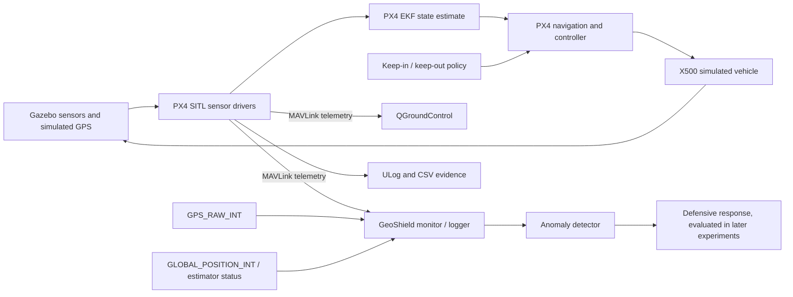

# EXPERIMENT 01 — NORMAL AUTONOMOUS FLIGHT

**Project:** GeoShield
**Scenario:** Padova, Italy
**Branch:** `ignacio-day2-simulation`
**Execution date:** 14 November 2026
**Status:** Completed in PX4 SITL; analysis evidence retained locally

## Abstract

This experiment establishes GeoShield's normal-flight baseline in the Padova simulation. An X500 vehicle running PX4 SITL flew from point A at Riviera Paleocapa to point B at Torre Archimede and returned along the reverse of a planner-generated route. The path avoided the two configured keep-out circles. The flight used simulator GPS and normal PX4 estimation and navigation; no GPS manipulation was performed. PX4 telemetry CSVs and a desktop recording are retained as evidence. The measurements below are derived from the captured telemetry, while independent proof of geofence enforcement and a clear continuous 3D view of the vehicle remain pending.

## 1. Purpose in the GeoShield research architecture

GeoShield is a university research project studying GPS-data manipulation against autonomous drones in software simulation, detecting anomalous behavior, and evaluating defensive responses based on geofencing and telemetry. Experiment 01 is the control condition: it records how the system behaves with simulator-provided GPS and no manipulation. Later experiments can compare their trajectories, estimator residuals, alerts, and defensive outcomes against this baseline.

The intended architecture is:

This diagram describes the target research architecture. In Experiment 01, the normal planner/flight script, PX4, Gazebo, QGroundControl, and the script's CSV logging were used. The dedicated live detector and an automated GeoShield defensive response were not run as part of this flight.

### 1.1 Position signals are not interchangeable

| Signal | Meaning | What this experiment can establish |
|---|---|---|
| Simulator GPS | GPS sensor measurements generated by Gazebo/PX4 SITL and exposed in MAVLink as `GPS_RAW_INT`. | The CSV contains the GPS-reported track sampled during the run. It does not, by itself, prove the estimator accepted every measurement. |
| PX4 EKF estimate | PX4's fused navigation state, exposed here through `GLOBAL_POSITION_INT` and estimator-status messages. | The CSV contains the estimate output. This is the navigation-state telemetry, not a second independent GPS receiver. |
| QGroundControl display | Vehicle telemetry and mission/fence graphics rendered by QGC. The map marker is driven by telemetry received from PX4. | A visible marker/route helps inspect the mission, but a changed marker alone does not prove that the EKF consumed a manipulated GPS position. |
| Navigation input | The state estimate used by PX4 navigation/control, with route targets supplied by the flight script over MAVLink. | The autonomous motion followed the target route in normal SITL operation. The available logs do not constitute a full estimator-internal audit. |

All work in this project is software simulation. No physical aircraft or RF interference was used.

## 2. Geographic scenario and safety volumes

Coordinates and radii are defined once in [`code/python/zones.py`](../../code/python/zones.py); this report does not duplicate them in executable configuration.

| Feature | Scenario description | Coordinates / radius |
|---|---|---|
| A / HOME | Riviera Paleocapa, departure and spawn point | 45.4021, 11.8670 |
| B | Torre Archimede, destination | 45.4113328, 11.8878209 |
| Keep-out 1 | Palazzo Bo | 45.4067383, 11.8773940; 220 m radius |
| Keep-out 2 | Palazzo Liviano | 45.4079860, 11.8714491; 150 m radius |
| Keep-in | Padova operational region | 45.40672, 11.87741; 1,500 m radius |

A keep-in volume defines the region in which the vehicle is allowed to operate; a keep-out volume defines an exclusion region the planned path should not enter. Their intended use is to bound route planning and provide PX4 with a geofence policy. Route planning around zones and PX4 geofence enforcement are distinct mechanisms: a route that avoids a circle is not, by itself, proof that PX4 would reject an attempted breach.

## 3. System components and code responsibilities

| Component / file | Responsibility | Experiment 01 status |
|---|---|---|
| PX4 Autopilot SITL | Simulated flight stack, estimator, navigation, arming checks, and MAVLink. | Used; preflight reported OK before takeoff. |
| Gazebo Harmonic / Gazebo Sim 8 | Physics, sensors, Padova world, and 3D view. | Used with the Padova world and X500. |
| X500 | Simulated multirotor airframe. | Used. |
| QGroundControl | GCS connection, telemetry, map, mission, and geofence visualization. | Connected during the run; see recording limitations below. |
| MAVLink / `pymavlink` | Vehicle command and telemetry transport. | Used by `plan_and_fly.py`; QGC connected on its separate GCS link. |
| `code/python/zones.py` | Single source of scenario coordinates and radii. | Imported by the planner and flight script. |
| `code/python/planner.py` | Visibility-graph/Dijkstra path around keep-out circles. | Used to generate the outbound route and its reverse. |
| `code/python/plan_and_fly.py` | Plan, issue takeoff/reposition/RTL commands, and write telemetry CSVs. | Used for this flight. |
| `code/python/upload_fence.py` | Upload PX4 fence return point, keep-in, and keep-out circles while preserving/reporting PX4 limits. | Used in setup in the earlier session; this flight log does not independently record fence parameters or fence-event status. |
| `code/python/make_qgc_plan.py` | Generate a QGC `.plan` containing circles and the A–B mission. | Available; this flight was flown by `plan_and_fly.py`, not by executing the QGC plan file as the route controller. |
| `code/python/upload_mission.py` | Upload and read back a mission without arming. | Available and used earlier to verify the QGC mission transfer; it did not fly this run. |
| `code/python/logger.py` | Standalone MAVLink telemetry logger. | Not run concurrently; the flight script wrote the CSV evidence itself. |
| `code/python/detector.py` | Live GPS/EKF divergence, innovation-ratio, and jump rules. | Not run during this baseline flight; detector performance is not claimed here. |
| `code/python/analyze.py` | Offline analysis of recorded telemetry. | Not run to generate the metrics in this report; the reported distance/clearance figures were computed directly from the flight CSV samples. |

## 4. Method

The documented sequence was: configure HOME=A; start PX4 SITL and the Padova Gazebo world; spawn the X500; connect QGroundControl; prepare the geofence and A–B route; check the route against both keep-out zones; check PX4 preflight; run the normal flight; and review the video and telemetry. The successful run used `python3 plan_and_fly.py` from `/home/ignacio/geoshield/`.

Immediately before takeoff, `commander check` returned `Preflight check: OK`; vehicle status was disarmed and the QGC heartbeat was valid. PX4 accepted arming and takeoff commands. The script planned a 2,010 m outbound route with seven nodes including A, flew the six subsequent target waypoints, reversed those targets for the return, issued RTL for final landing, and reported the vehicle on the ground. The final sampled position was 45.402099, 11.867000, and PX4 land detection reported `landed: True`.

The successful run is identified by its CSV directory and PX4 ULog; the video is supporting visual evidence, not the authoritative flight-event record.

## 5. Results and evaluation

The route planner's reported 2,010 m is an expected plan length. The following measured values were computed from the successful run's `gps_raw.csv` unless otherwise stated. Distance is the sum of great-circle distances between consecutive valid samples; clearances are sample minima relative to each circle's boundary, so they are telemetry-sample estimates rather than a continuous collision proof.

| Metric | Result | Evidence / status |
|---|---:|---|
| Outbound planned distance | 2,010 m | Planner output; expected path length. |
| Total sampled distance, A–B–A | 4,010 m | Measured from 3,128 valid `GPS_RAW_INT` samples. |
| Flight telemetry duration | 601.1 s (10 min 1.1 s) | First-to-last valid GPS CSV sample; measured. |
| Planned route nodes | 7 including A | Planner output. |
| Commanded destination waypoints | 6 outbound + 6 return | Flight script output; A is the initial point, not a commanded waypoint. |
| Minimum sampled distance to Palazzo Bo center | 292.1 m | GPS sample minimum; radius 220 m, giving 72.1 m sampled clearance. |
| Minimum sampled distance to Palazzo Liviano center | 545.9 m | GPS sample minimum; radius 150 m, giving 395.9 m sampled clearance. |
| Difference from nominal round trip (4,020 m) | −10 m (−0.25%) | Comparison of sampled distance with twice the planner's 2,010 m; not a controller tracking-error statistic. |
| Keep-in / keep-out enforcement during this run | Pending validation | Route samples were outside the configured exclusion circles; this run's CSV does not independently prove PX4 fence state or record a fence-breach counter. |
| Navigation events | Takeoff accepted; 6 outbound and 6 return targets reached; RTL accepted; landing detected | Flight-script/PX4 console output. |
| GPS manipulation | None | Normal simulator GPS baseline by procedure; this is not a spoofing-resistance test. |

The sampled route stayed outside both keep-out radii and returned to A. The fact that the route planner selected clearance around Palazzo Bo is consistent with the expected normal behavior. The separate question of whether every PX4 fence parameter was active and enforced for every sample remains open for an auditable geofence-specific validation.

## 6. Evidence and traceability

| Evidence | Location | Details |
|---|---|---|
| Screen recording | [Drive video link](evidencia/README.md) | User-provided Google Drive link to `Experimento 1.mp4`. Local metadata: H.264 1920 x 1080 at 30 fps with AAC audio; duration 649.733 s. The video binary is hosted outside Git. |
| Flight CSVs | [`evidencia/telemetria/`](evidencia/telemetria/) | `gps_raw.csv`, `global_pos.csv`, `est_status.csv`; originally saved under `/home/ignacio/geoshield/logs/20261114_114327_planfly/`. |
| PX4 ULog | [`evidencia/registro-px4/2026-11-14_10-43-27.ulg`](evidencia/registro-px4/2026-11-14_10-43-27.ulg) (local copy) | Full PX4 log for the successful run; ignored by Git due its size. |
| Scenario definition | [`code/python/zones.py`](../../code/python/zones.py) | Source of coordinates and circle radii. |
| Flight implementation | [`code/python/plan_and_fly.py`](../../code/python/plan_and_fly.py) | Mission, telemetry collection, and normal return logic. |

The recording shows Gazebo Sim and QGroundControl side by side, with Padova map/mission context visible in QGC and the Padova world open in Gazebo. A sampled frame at 05:00 shows the QGC map and both application windows, but the X500 is not clearly identifiable in Gazebo's 3D viewport at that moment. Therefore the video can document the desktop setup and QGC mission context, but it cannot by itself prove continuous vehicle visibility, exact position synchronization, EKF GPS acceptance, fence enforcement, or the absence of spoofing. The Gazebo `currently_tracked` topic was separately observed in `FOLLOW` mode for entity `x500_0`; that runtime check is not embedded as machine-readable evidence in the MP4.

The repository stores the Drive link rather than the MP4 binary. The original video remains in the user's Downloads folder. Verify that the Drive link is accessible to the intended collaborators.

## 7. Relationship to later experiments

| Experiment | Scenario | Comparison enabled by this baseline |
|---|---|---|
| 01 — Normal Autonomous Flight | Valid simulated GPS, route planner, and intended geofence. | Reference trajectory, speed/altitude profile, GPS–EKF separation, innovation ratios, and ordinary navigation events. |
| 02 — Gradual GPS Manipulation | Gradual simulated GPS drift. | Changes in GPS–EKF divergence over time and the point at which the estimator or detector responds. |
| 03 — Abrupt GPS Manipulation | Sudden simulated position change. | Position jumps, estimator innovations, mode changes, and recovery behavior. |
| 04 — GeoShield Defence | Simulated manipulation with anomaly detection and defensive response. | Detection latency, defensive action, route containment, and recovery relative to the normal baseline. |

Useful baseline variables include `GPS_RAW_INT` and `GLOBAL_POSITION_INT` positions, their time-aligned separation, `ESTIMATOR_STATUS` position/velocity innovation ratios, ground speed, commanded waypoint error, altitude, mode/arming transitions, and geofence state/events. Detector thresholds should be calibrated and evaluated using multiple runs, not inferred from a single trajectory.

## 8. Limitations and next work

1. Validate which GPS samples the PX4 EKF accepted, using estimator aid-source/status data and timestamp alignment; a QGC marker is insufficient.
2. Retain and analyze logs for repeated baseline runs; quantify normal variation before fixing detector thresholds.
3. Independently verify the uploaded geofence parameters, fence polygons/circles, breach status, and PX4 response during the exact flight.
4. Confirm continuous X500 visibility and camera-follow framing in a new recording; the reviewed MP4 frame does not clearly show the aircraft in Gazebo.
5. Evaluate false positives and false negatives for gradual and abrupt cases, and measure detection latency.
6. Implement and test defensive responses only in software simulation, with safe-state and recovery criteria.
7. Confirm that the Drive share link remains available to the project collaborators.

Experiment 01 establishes normal operation only. It does **not** demonstrate resistance to GPS spoofing or validate GeoShield's detector/defence efficacy.

## References inside this repository

- [`README.md`](../../README.md)
- [`docs/traspaso-escenario.md`](../traspaso-escenario.md)
- [`code/python/zones.py`](../../code/python/zones.py)
- [`code/python/planner.py`](../../code/python/planner.py)
- [`code/python/plan_and_fly.py`](../../code/python/plan_and_fly.py)
- [`code/python/upload_fence.py`](../../code/python/upload_fence.py)
- [`code/python/detector.py`](../../code/python/detector.py)
- [`code/python/logger.py`](../../code/python/logger.py)
- [`code/python/analyze.py`](../../code/python/analyze.py)
- [`code/python/make_qgc_plan.py`](../../code/python/make_qgc_plan.py)
